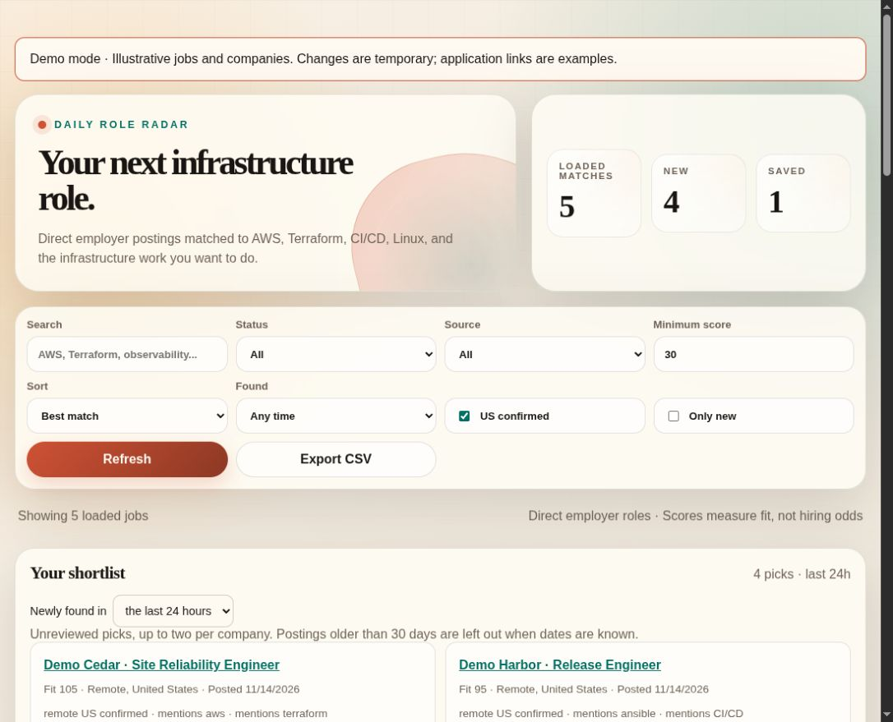
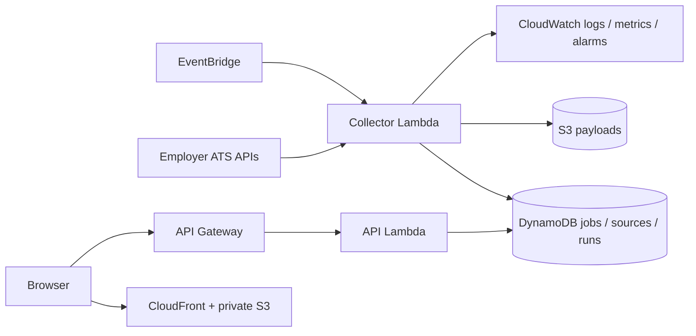

# Job Finder

[](https://github.com/SBellamy/job-finder/actions/workflows/ci.yml)

A personal job-search dashboard that finds remote US infrastructure roles directly from employers, explains the fit, and keeps track of what has been reviewed.

Built with Python, AWS Lambda, DynamoDB, S3, API Gateway, CloudFront, EventBridge and Terraform. The same collection and API logic also runs locally without AWS.

## Try the dashboard

Requires Python 3.12+. From the repository root:

```bash
PYTHONPATH=src python3 -m job_finder serve --demo
```

Open [localhost:3000](http://127.0.0.1:3000). Demo mode provides disposable illustrative companies and roles. Save jobs, change filters, read details and follow boards; closing the server discards the sample data. It does not require credentials or change existing local job files.



## Collect real jobs

Start with direct employer boards rather than waiting for search discovery:

```bash
PYTHONPATH=src python3 -m job_finder seed-sources --sources config/sources.starter.json
PYTHONPATH=src python3 -m job_finder collect --sources config/sources.starter.json
PYTHONPATH=src python3 -m job_finder serve
```

The starter boards were checked against public ATS APIs on November 14, 2026. Hiring changes; the catalog records subsequent failures and source quality. Run `collect` again to refresh. Local collection and dashboard review should run sequentially because the JSON store is intended for one process at a time.

To expand coverage through search while retaining catalog sources:

```bash
PYTHONPATH=src python3 -m job_finder collect \
  --discovery-keywords '["devops","sre","platform engineer","cloudops","terraform","aws"]'
```

Supported ATS providers: Ashby, Greenhouse, Lever, SmartRecruiters and Workable. The dashboard can follow an employer by pasting its board or job URL. A followed board is collected on a later run; following alone does not trigger a crawl.

## Daily review

- **Shortlist:** newly found, unreviewed matches from the past 24 hours, 3 days or 7 days; at most two per company.
- **Fit and caveats:** prioritize AWS, Terraform, Ansible, CI/CD, Linux, automation, observability and release engineering. Show contract, Kubernetes-heavy and location uncertainty separately.
- **Freshness:** distinguish employer publication from discovery. Greenhouse edit timestamps are not presented as publication dates.
- **Review:** save, dismiss with a reason, mark applied and keep notes. Read full descriptions on demand.
- **Filters:** search across stored descriptions, ATS source, score, status, confirmed US evidence and jobs found since the previous visit. Filters apply before pagination and to CSV export.
- **Feedback:** “already seen” does not downrank similar DevOps roles. Company and role-fit feedback are treated separately.

The [search profile](docs/search-profile.md) documents the defaults and unknowns. Scores are fit signals, not percentages or hiring predictions. “US confirmed” means country evidence; state residency and authorization requirements still need review.

Build a digest from local data:

```bash
PYTHONPATH=src python3 -m job_finder digest --hours 24 --limit 10 --min-score 60
```

## AWS architecture



Collection normalizes and scores postings before upserting them. Review state survives later crawls. A persistent board catalog provides coverage when search discovery fails. Collector locking, structured logs, freshness metrics and alarms make failures visible.

See [architecture and tradeoffs](docs/architecture.md) for data flow, operational behavior and limits. DynamoDB reads remain scan-based and the API is a personal deployment without user authentication; these are explicit limitations, not claims of production scale.

## Deploy and verify

```bash
cd infra/terraform
cp terraform.tfvars.example terraform.tfvars
# Set region, allowed_origin, collection settings and an optional budget email.
terraform init
terraform validate
terraform plan
terraform apply
```

Terraform outputs the dashboard URL, API base URL, collector Lambda name, jobs table and raw payload bucket. Set `allowed_origin` to the dashboard's CloudFront origin. Use `terraform output` to retrieve deployed values; do not commit local state or variables.

Known boards can also be seeded into the deployed source catalog:

```bash
curl -X POST "$API_BASE_URL/sources" \
  -H 'Content-Type: application/json' \
  -d '{"url":"https://jobs.lever.co/your-company"}'
```

After deployment, run a collection to refresh existing records with the current normalization and scoring. Check `GET /health/freshness`, `GET /jobs` and the dashboard's review actions. A local test run does not substitute for a Terraform drift check or a deployed smoke test.

## Development

```bash
python3 -m unittest discover -s tests -v
node --check frontend/app.js
node --test tests/frontend.test.cjs
```

CI runs Python regression tests, frontend checks and Terraform validation. Tests cover geography, role relevance, feedback, provider fields, shortlist freshness/deduplication, search pagination and preservation of review state.

```text
src/job_finder/      collection, normalization, scoring, API, CLI, local server
src/job_finder/ats/  provider adapters
frontend/           dependency-free dashboard
infra/terraform/    AWS infrastructure
config/             example and verified starter boards
tests/             behavioral regression tests
docs/              search profile and architecture decisions
```

## Roadmap and operations

The [roadmap](ROADMAP.md) prioritizes access control, availability reconciliation, search quality, reproducible releases and measured performance. The [runbook](docs/runbook.md) covers deployment checks, rollback and collection failures.

## Current scope

The dashboard and CLI generate a shortlist; email delivery is not implemented. Non-ATS career pages are not collected. Closed postings are not yet reconciled, and source coverage is incomplete. [The backlog](BACKLOG.md) tracks the remaining product work.
