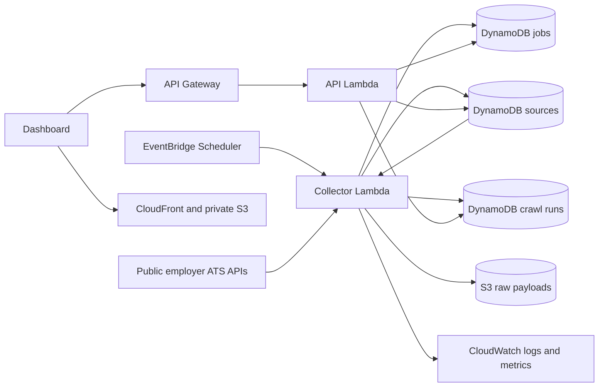

# Architecture and tradeoffs

## Deployment

Terraform packages the Python source and uploads the three static frontend assets plus a generated API configuration. The CLI uses local JSON repositories; the local HTTP server shares the same API application functions as Lambda. Demo mode uses a temporary directory and illustrative fixtures.

## Data and review state

Provider-specific adapters produce a common record before normalization and ranking. Job identity uses the ATS provider and provider job ID, with a canonical URL fallback. Upserts preserve first discovery time, review status, notes and review metadata. Last-seen time reflects a successful fetch, not a user action.

The source catalog persists board identity, health, manual priority and blocking. Company size and tags survive catalog round-trips. Search discovery supplements known boards; seeded/manual boards are prioritized. Source quality counts strong eligible matches rather than treating all high keyword scores as useful results.

Feedback distinguishes intent: a duplicate, location mismatch or timing dismissal does not teach a dislike of that title. A company-fit dismissal affects the company, while off-target role feedback affects title tokens. The AWS feedback projection includes the dismiss reason, matching local behavior.

## Ranking and presentation

Keyword matching uses word boundaries so `laws` does not count as AWS and `Business` does not count as US. Overlapping title phrases contribute one title bonus. Obvious off-target titles and generic roles without infrastructure intent cannot cross the default score threshold merely by listing cloud tools.

The shortlist uses a bounded first-seen window, country confirmation by default, duplicate suppression, reviewed-history suppression and a per-company cap. Search, source, first-seen and US-confirmation filters run before pagination and use the same behavior for export. AWS requests project full descriptions only when text search needs them.

## Reliability

- Conditional collector locking prevents overlapping Lambda collection runs; locks expire.
- Known boards can still collect when search discovery fails.
- Structured run/source logs and metrics support troubleshooting.
- A freshness endpoint and alarm track completed collection rather than only Lambda invocation success.
- Retry/backoff handles transient ATS failures.
- Browser requests ignore obsolete responses; one failing insight panel does not blank the others.

## Deliberate limits

- The deployed ranked/newest/status reads use compact global secondary indexes, enabled after a guarded backfill and parity verification on November 15, 2026. See [measured performance](performance.md). Full-description search still scans the base table; deep offset pages replay prior index pages. See [the indexed feed rollout](feed-indexes.md).
- The shortlist considers at most 1,000 recent candidates and 1,000 reviewed records per request. It is a personal-scale feed.
- Closed jobs are not reconciled against full successful board snapshots yet. Last-seen warnings help review, but do not prove a posting is open.
- Search indexing is incomplete. The starter catalog is a small verified starting point, not comprehensive market coverage.
- The deployed API has no user authentication; CORS is not access control. Authenticated review writes are needed before offering this as a shared service.
- Terraform manages the resources, but a clean local test run does not establish that the deployed environment has no drift. Check a real plan and perform a deployed smoke test when releasing.
- Budget alarms notify; they do not stop spending.
